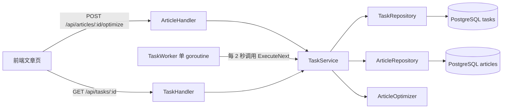

# 单实例异步任务设计：PostgreSQL 任务表与进程内 Worker

## 适用范围与结论

本项目目前主要在本地以单个后端进程运行，任务量较小。继续使用 PostgreSQL 的 `tasks` 表作为任务队列，并在同一个 Go 进程中运行一个后台 worker。HTTP 接口负责持久化任务并及时返回；worker 稍后执行；前端查询任务状态。此方案不需要 Redis Streams，也不需要为每个请求单独创建 goroutine。

本文先描述**当前已实现**的链路，再列出在保留该方案前提下建议补齐的可靠性措施。后半部分是设计建议，不代表代码已经实现。接口字段详见 [任务模块](任务模块.md)。

## 组件与职责



| 组件 | 当前职责 |
| --- | --- |
| `ArticleHandler.Optimize` | 接收文章 ID，调用任务服务，返回任务对象；不等待优化执行 |
| `TaskService` | 检查文章、创建或复用运行中任务；查询任务；执行优化并更新任务状态 |
| `TaskRepository` | 从 `tasks` 表查找、创建和更新任务 |
| `TaskWorker` | 由 `main.go` 用一个 goroutine 启动，定时调用 `ExecuteNext` |
| `ArticleOptimizer` | 执行文章优化；当前注入 `FakeArticleOptimizer` |
| 前端任务页 | 对 `pending`、`processing` 任务每 2 秒查询一次详情或列表 |

任务记录在 PostgreSQL 中，即使浏览器关闭，任务仍可由后端进程执行。worker 与 HTTP 服务属于同一进程；后端进程停止时，worker 也停止。

## 当前任务链路

### 1. 创建并返回任务

前端请求 `POST /api/articles/:id/optimize`。`TaskService.CreateArticleOptimizeTask` 先读取文章，再查找同一文章、同一类型且状态为 `pending` 或 `processing` 的任务：存在则返回该任务；否则写入 `type=article_optimize`、`status=pending` 的新任务。响应中的任务 ID 用于后续查询。创建请求不运行优化器。

### 2. 后台领取并执行

`main.go` 执行 `go taskWorker.Start(context.Background())`。worker 使用 2 秒的 ticker，每次调用 `ExecuteNext`；Repository 按 `created_at ASC` 取最早的 `pending` 任务。Service 将其标记为 `processing` 并写入 `started_at`，随后读取文章、调用优化器并写回文章。

当前 worker 串行执行：一次 `ExecuteNext` 完成后才进入下一次循环。因此一个慢任务会延迟后面的任务，实际吞吐也受单个任务执行时间影响。

### 3. 记录结果并让前端观察

执行成功时，先保存文章的新内容、`ai_optimized=true`、`status=1`，再把优化结果写入任务 `result`，将状态改为 `completed` 并写入 `finished_at`。执行失败时，任务改为 `failed` 并记录 `error`、`finished_at`。前端使用 `GET /api/tasks/:id` 查询状态；文章详情页在发现任务完成后重新加载文章。

```text
pending → processing → completed
                     ↘ failed
```

## 当前约束与已知风险

| 情况 | 当前行为与影响 |
| --- | --- |
| 后端在 `processing` 时退出 | `processing` 已在数据库写入，但进程可能来不及写最终状态；worker 只选 `pending`，重启后这条任务仍显示 `processing`，其执行结果未知 |
| 同一文章同时发起两个创建请求 | “先查后建”未用数据库约束或事务保证原子性，可能生成重复任务 |
| 启动多个后端实例或 worker | “先查任务、再标记 processing”不是原子领取，可能重复执行；因此当前方案限定单实例单 worker |
| 文章已写回，但完成状态更新失败 | 文章与任务分别更新，可能出现文章已优化而任务仍显示处理中 |
| 自动重试 | 创建时 `max_retries=3`，但目前没有重试分支或重试计数逻辑 |
| 再次执行同一优化 | 当前模拟优化器会在正文后追加内容，重复执行可能再次追加 |

仓库的 SQL 迁移包含 `retry_count`，当前 Go `Task` 模型没有该字段；应用启动执行的是 GORM `AutoMigrate`。在实现重试前，需要先核对实际数据库结构和迁移路径，不能仅凭 SQL 文件认定运行时已有完整重试能力。

## 保留当前方案的改进设计

### 第一阶段：恢复进程中断的任务

`processing` 是开始执行前写入数据库的状态。若进程在优化器运行中、文章写回后，或任务最终状态写入前退出，就没有机会把它改成 `completed` 或 `failed`。因此重启后仍可能看到旧的 `processing` 记录。这里把 `failed` 定义为“任务未被确认完成”，既包括执行时明确报错，也包括进程中断；`error` 字段用于区分两种原因。

对本地单实例，在**确认旧 worker 已停止**后，于新进程启动 worker 前批量将遗留的 `processing` 改为 `failed`，写入 `error="上次执行被中断"`，并将 `finished_at` 设为恢复时刻。这个时间表示新进程确认任务已中断的时间，不一定是旧进程实际退出的时间。`pending`、`completed` 和原本的 `failed` 不应被修改；恢复 SQL 失败时应终止启动，避免带着未处理的任务状态启动 worker。

由于文章写回与任务状态更新尚未放在同一事务中，被标为 `failed` 的中断任务可能已经修改了文章；第一阶段不自动重跑，用户重新发起前应核对文章内容。实现后需验证“无遗留任务”“中途退出”“文章已写回但任务未完成”和“重复启动”四种场景。若以后允许多个后端进程，不能在启动时直接认定其他进程的 `processing` 已中断，需增加任务归属或心跳判断。具体修改步骤与参考代码见 [任务中断恢复编码指南](任务中断恢复编码指南.md)。

### 第二阶段：减少重复与状态不一致

若需要承受并发创建请求，为同一文章、同一任务类型的运行中任务增加数据库级唯一约束，或把查找与创建放进能保证互斥的事务中；遇到冲突时读取并返回已有任务。即使维持单 worker，这也能避免两个 HTTP 请求同时创建任务。

文章写回与任务完成状态最好在一个 PostgreSQL 事务中提交，避免“文章已更新，任务却未完成”。优化器调用放在事务之外，获取结果后再开始短事务。若未来增加自动重试或多个 worker，还要为任务执行设计幂等写回，避免重复追加内容；仅增加重试次数不足以保证正确性。

### 第三阶段：有实际吞吐需求再并发

如果本地任务积压，再考虑有限数量的 worker goroutine。增加 worker 前，必须把领取任务改成数据库原子操作，使一条 `pending` 任务只能被一个 worker 领走，并设置并发上限。当前不需要 Redis Streams；新增 Redis 队列会让任务状态同时存在于 Redis 和 PostgreSQL，带来两处写入的同步问题。

## 实现边界

- 任务创建成功表示已持久化或复用任务，不表示优化成功。
- 当前仅执行 `article_optimize`；`article_publish` 类型和 `canceled` 状态尚无对应流程。
- 当前没有取消、自动重试、超时控制和优雅停机流程；启动恢复及其他改进都需要另行实现，当前代码仍可能留下遗留的 `processing` 任务。
- 当前模拟优化器用于验证任务链路，不能将其输出视为真实 AI 优化结果。

## 代码依据

- [启动与依赖组装](../../cmd/main.go)、[路由](../../internal/api/router.go)、[创建任务入口](../../internal/api/article.go)
- [任务服务](../../internal/service/task_service.go)、[任务存储](../../internal/repository/task.go)、[任务模型](../../internal/model/task.go)
- [后台 worker](../../internal/worker/task_worker.go)、[模拟优化器](../../internal/ai/fake_optimizer.go)
- [前端文章详情](../../../nebula-ai-web/src/pages/ArticleDetail.tsx)、[前端任务详情](../../../nebula-ai-web/src/pages/TaskDetail.tsx)
