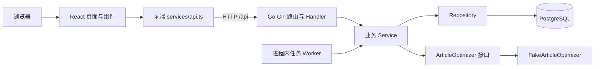
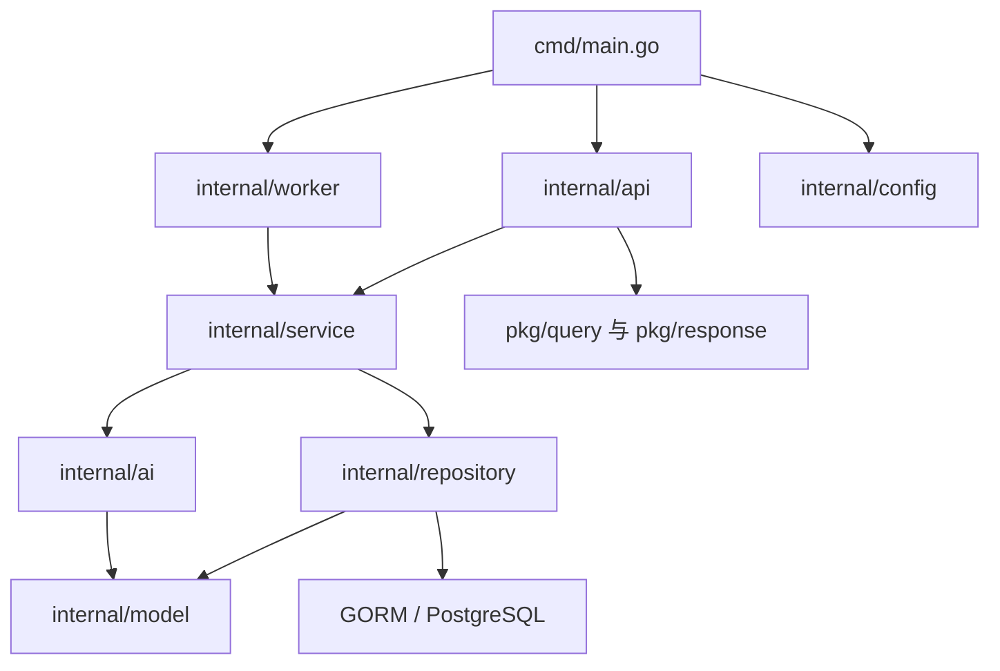
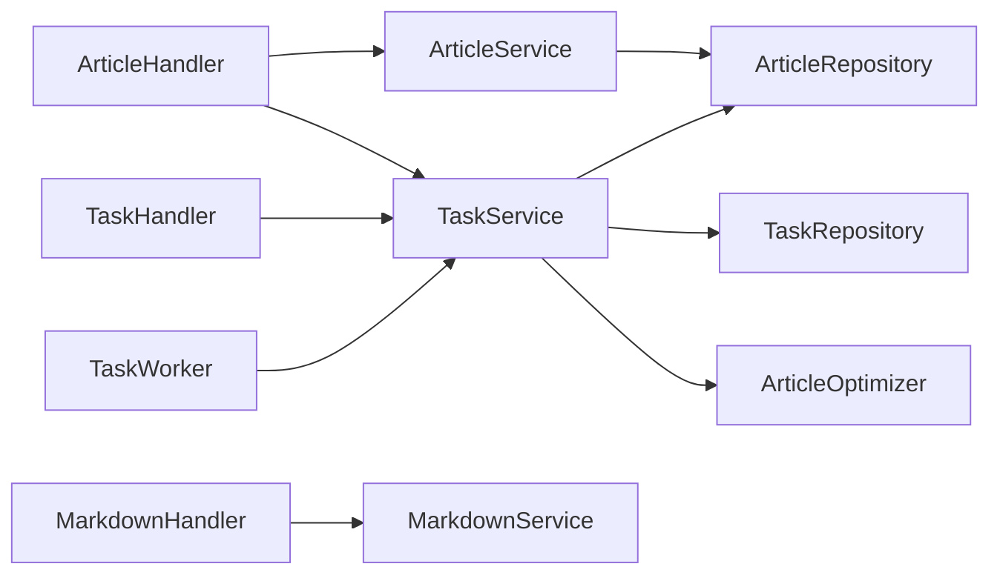

# 项目模块分层（当前实现）

本文依据当前工作区的 `nebula-ai-web` 与 `nebula-ai-api` 代码，描述模块职责、依赖方向和主要调用链。两个目录并列：前者是 React 前端，后者是 Go HTTP 服务；PostgreSQL 保存文章和任务数据。这里记录已经落地的实现，接口细节见 [文章模块](文章模块.md) 和 [任务模块](任务模块.md)。

## 总体结构

HTTP 请求走 `页面 → API 客户端 → Handler → Service → Repository → PostgreSQL`；后台任务走 `Worker → TaskService → Repository / ArticleOptimizer`。`cmd/main.go` 负责组装依赖、连接数据库、注册路由并启动 worker 与 HTTP 服务。

## 目录与职责

| 层次 | 位置 | 当前职责 |
| --- | --- | --- |
| 前端页面 | `nebula-ai-web/src/pages` | 首页、文章列表/编辑/详情、任务列表/详情；处理用户交互和页面级加载状态 |
| 前端组件 | `nebula-ai-web/src/components` | 布局、表单、提示、进度展示及 Markdown 预览 |
| 前端状态与类型 | `nebula-ai-web/src/stores`、`src/types`、`src/utils` | Zustand 文章列表状态、前后端数据类型、任务状态展示工具 |
| 前端 HTTP 客户端 | `nebula-ai-web/src/services/api.ts` | Axios 基础地址、统一响应解包和文章/任务/Markdown 接口封装 |
| 启动与依赖组装 | `nebula-ai-api/cmd/main.go`、`internal/config` | 读取配置、连接 PostgreSQL、自动迁移模型、构造各层对象、启动服务 |
| HTTP 接入层 | `nebula-ai-api/internal/api` | Gin 路由、请求绑定与校验、参数解析、调用 Service、返回 JSON |
| 业务层 | `nebula-ai-api/internal/service` | 文章 CRUD、状态与平台记录、任务创建/执行、Markdown 转换 |
| 后台执行层 | `nebula-ai-api/internal/worker` | 定时轮询待处理任务并调用 TaskService |
| 优化器抽象 | `nebula-ai-api/internal/ai` | 定义文章优化接口和结果；当前注入模拟优化器 |
| 数据访问层 | `nebula-ai-api/internal/repository` | 使用 GORM 读写文章、任务及执行分页/状态查询 |
| 数据模型 | `nebula-ai-api/internal/model` | `Article`、`Task` 及状态/类型定义，映射数据库和 JSON 字段 |
| 公共 HTTP 辅助 | `nebula-ai-api/pkg/query`、`pkg/response` | 列表分页参数与结果、统一成功/错误响应 |
| 数据库与部署辅助 | `nebula-ai-api/migrations`、`docker-compose.yml` | SQL 迁移文件；Compose 提供 PostgreSQL、Redis 和迁移服务 |

前端 Vite 开发服务器使用 `3000` 端口，并将 `/api` 代理到本地 `8080`；前端也可通过 `VITE_API_BASE_URL` 指定 API 地址。后端默认监听 `8080`，通过 `SERVER_PORT` 修改。

## 后端依赖方向

`main.go` 将 `ArticleRepository`、`TaskRepository` 注入对应 Service，再将 Service 注入 Handler 和 Worker。`ArticleHandler` 额外依赖 `TaskService`，因为创建优化任务的 HTTP 入口位于文章路由下。`MarkdownService` 不访问数据库，直接使用 Goldmark 把 Markdown 转换为 HTML。`pkg/query` 和 `pkg/response` 只承担 HTTP 通用结构，不包含业务存储逻辑。

## 后端业务模块如何分层

当前代码按**技术层**放置文件，例如所有 Handler 在 `internal/api`、所有 Service 在 `internal/service`。从**业务模块**看，同一模块的实现分布在这些目录中：

| 业务模块 | HTTP 接入层 `internal/api` | 业务层 `internal/service` | 数据访问层 `internal/repository` | 模型及执行组件 |
| --- | --- | --- | --- | --- |
| 文章模块 | `router.go` 的 `/articles` 路由、`article.go` 的 `ArticleHandler` | `article_service.go` 的 `ArticleService` | `article.go` 的 `ArticleRepository` | `model/article.go` 的 `Article`、`ArticleStatus` |
| 任务模块 | `router.go` 的 `/tasks` 路由、`task.go` 的 `TaskHandler`；创建入口还在 `ArticleHandler.Optimize` | `task_service.go` 的 `TaskService` | `task.go` 的 `TaskRespository` | `model/task.go` 的 `Task`、任务类型/状态；`worker/TaskWorker`；`ai/ArticleOptimizer` |
| Markdown 转换模块 | `router.go` 的 `/markdown` 路由、`markdown.go` 的 `MarkdownHandler` | `markdown_service.go` 的 `MarkdownService` | 无 | Goldmark 转换器；无持久化模型 |

### 文章模块：管理文章本身

| 层次 | 文件与职责 |
| --- | --- |
| Handler | [internal/api/article.go](../../internal/api/article.go)：绑定创建/更新请求、解析文章 ID、调用 Service 并封装响应。文章 CRUD、状态更新和平台记录入口在此；`Optimize` 方法把创建优化任务委托给 `TaskService`。 |
| Service | [internal/service/article_service.go](../../internal/service/article_service.go)：创建草稿，按页或状态查询，部分字段更新，删除，更新状态，以及向文章追加发布平台。 |
| Repository | [internal/repository/article.go](../../internal/repository/article.go)：GORM 的 `articles` 表读写、计数、分页和按状态筛选。 |
| Model | [internal/model/article.go](../../internal/model/article.go)：定义文章字段与状态；`AddPublishPlatform`、`IsPublishedTo` 处理逗号分隔的平台字段。 |

典型调用是 `ArticleHandler.Update → ArticleService.Update → ArticleRepository.GetByID/Update → articles 表`。`publish_platform` 只记录平台名；没有发布器调用或发布任务创建。

### 任务模块：管理异步处理

| 层次 | 文件与职责 |
| --- | --- |
| Handler | [internal/api/task.go](../../internal/api/task.go) 负责列表、详情查询；[ArticleHandler.Optimize](../../internal/api/article.go) 是唯一的任务创建 HTTP 入口。 |
| Service | [internal/service/task_service.go](../../internal/service/task_service.go)：验证文章、复用运行中任务或创建待处理任务；提供查询；领取并执行任务，写入执行结果或错误。 |
| Repository | [internal/repository/task.go](../../internal/repository/task.go)：GORM 的 `tasks` 表读写、分页、按文章筛选、查找运行中/待处理任务及状态更新。 |
| Model | [internal/model/task.go](../../internal/model/task.go)：定义任务类型、状态、关联文章 ID、输入输出、错误和时间字段。 |
| 执行组件 | [internal/worker/task_worker.go](../../internal/worker/task_worker.go) 每 2 秒调用 `TaskService.ExecuteNext`；[internal/ai/article_optimizer.go](../../internal/ai/article_optimizer.go) 定义优化接口，启动时注入 [FakeArticleOptimizer](../../internal/ai/fake_optimizer.go)。 |

任务创建链路是 `ArticleHandler.Optimize → TaskService.CreateArticleOptimizeTask → TaskRepository.Create → tasks 表`。后台执行链路是 `TaskWorker → TaskService.ExecuteNext/Execute → TaskRepository + ArticleRepository + ArticleOptimizer`。`TaskService` **直接依赖 `ArticleRepository`**：创建任务时检查文章，执行优化时读取并写回文章；当前没有通过 `ArticleService` 完成这些操作。

执行状态目前为 `pending → processing → completed/failed`。优化成功会写回文章标题、摘要、标签、正文，以及 `ai_optimized=true` 和文章状态 `1`。前端通过 `taskApi` 查询与轮询任务。`article_publish` 类型、`canceled` 状态和 `max_retries` 字段仅有定义或存储，没有发布、取消或自动重试流程。

### Markdown 转换模块：无数据库依赖

前端 `Markdown` 组件负责页面内预览。文章详情页需要 CSDN HTML 时，经 `markdownApi` 调用 `POST /api/markdown/convert/csdn`；后端由 [MarkdownHandler](../../internal/api/markdown.go) 验证请求，再由 [MarkdownService](../../internal/service/markdown_service.go) 使用 Goldmark 转换，并可加上 CSDN 容器。该模块没有 Repository，也不创建任务或保存转换结果；前端可以复制生成的 HTML。

### 模块之间的调用

图中 `ArticleHandler → TaskService` 是创建文章优化任务的跨模块入口；`TaskService → ArticleRepository` 是任务执行写回文章的跨模块依赖。Markdown 转换与文章、任务的后端业务对象没有直接依赖。上述组件在 [cmd/main.go](../../cmd/main.go) 中组装。

## 两条主要调用链

**保存文章：** `ArticleEditor.handleSave → articleApi.create/update → ArticleHandler.Create/Update → ArticleService.Create/Update → ArticleRepository → articles 表`。成功后前端跳转到文章详情页。文章列表页通过 `useArticleStore` 保存已加载的列表和删除后的本地状态；详情与编辑页主要使用组件本地状态。

**优化文章：** `ArticleDetail/ArticleEditor → articleApi.optimize → ArticleHandler.Optimize → TaskService.CreateArticleOptimizeTask → tasks 表`；随后 `TaskWorker.Start → TaskService.ExecuteNext/Execute → ArticleOptimizer → articles 表 + tasks 表`。前端通过 `taskApi.getDetail` 轮询，完成后重新读取文章。HTTP 创建任务和后台执行是两个阶段，不能把创建响应当作最终优化结果。

## 数据与运行边界

- 当前持久化数据在 PostgreSQL 的 `articles`、`tasks` 表。后端启动时调用 GORM `AutoMigrate`；仓库同时保留独立 SQL 迁移文件和 Compose 迁移服务。
- Compose 中定义了 Redis，配置层也读取 Redis、DeepSeek API Key 和发布器地址，但当前启动代码没有把这些接入业务链路。任务队列依赖 PostgreSQL 表和进程内 worker。
- `GET /api/health` 直接由路由返回 `{"status":"ok"}`；其余业务接口通过 `pkg/response` 使用统一响应结构。
- 旧的 [任务系统设计文档](../task_system_design.md) 包含早期方案，涉及的能力应以当前代码和本目录的模块文档为准。

## 主要代码入口

- 前端：[路由](../../../nebula-ai-web/src/App.tsx)、[API 客户端](../../../nebula-ai-web/src/services/api.ts)、[文章详情](../../../nebula-ai-web/src/pages/ArticleDetail.tsx)、[任务详情](../../../nebula-ai-web/src/pages/TaskDetail.tsx)
- 后端：[启动组装](../../cmd/main.go)、[路由表](../../internal/api/router.go)、[文章 Service](../../internal/service/article_service.go)、[任务 Service](../../internal/service/task_service.go)、[Markdown Service](../../internal/service/markdown_service.go)
- 执行与存储：[任务 Worker](../../internal/worker/task_worker.go)、[优化器](../../internal/ai/fake_optimizer.go)、[文章 Repository](../../internal/repository/article.go)、[任务 Repository](../../internal/repository/task.go)
